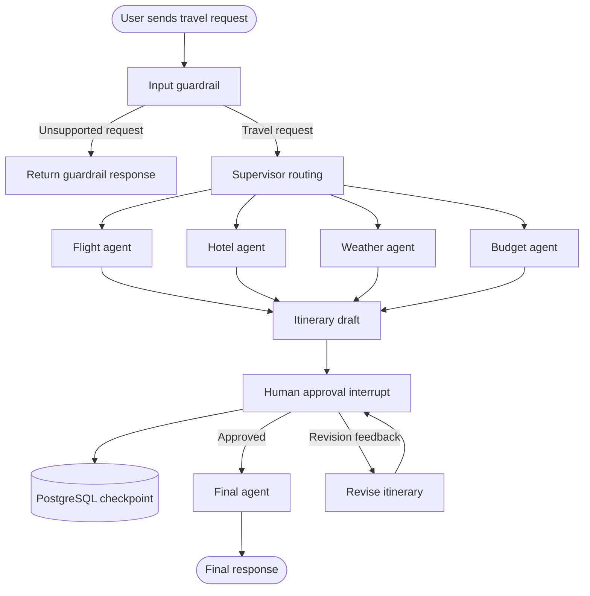

# Agent Workflow and HITL

## Processing steps

1. The user posts a travel request to `/api/travel`.
2. The guardrail checks for a supported travel-planning request.
3. The supervisor coordinates specialist agents; some use MCP data sources.
4. The itinerary agent drafts a plan using available context and feedback.
5. The graph invokes `interrupt` to request user approval; the thread is checkpointed in PostgreSQL.
6. The frontend sends a `thread_id`, `approved` flag, and optional feedback to `/api/travel/approve`.
7. The backend resumes with `Command(resume={...})`; approval routes to the final agent and rejection routes back to itinerary drafting.

**Known UI issue:** In the tested application, revised drafts did not consistently re-display the approve/revise controls. The diagram illustrates intended graph routing, not a claim that every browser interaction is currently verified end to end.
