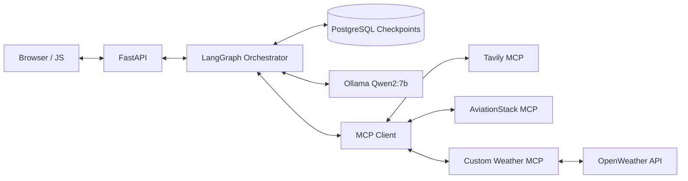

# System Architecture

TripMate AI is a browser-based travel planning assistant. FastAPI receives requests, LangGraph routes agent steps, Ollama provides local LLM inference, and PostgreSQL persists execution checkpoints. External MCP tools provide optional factual context.

## Components

| Component | Relevant code | Role |
|---|---|---|
| FastAPI | `app.py` | HTTP interface, static frontend, request and approval handlers |
| LangGraph | `backend.py` | State transitions, supervisor, specialist agents, guardrails, human approval interrupt |
| Ollama | `backend.py`, `mcp_client.py` | Local Qwen2:7b inference |
| Checkpointer | `backend.py` | PostgreSQL `PostgresSaver` persists thread state to resume interrupted execution |
| MCP client | `mcp_client.py` | Discover and invoke provider tools separately to isolate failures |
| Weather MCP | `custom_weather_mcp_server.py` | Exposes weather retrieval tools backed by OpenWeather |
| UI | `templates/`, `static/` | Form, itinerary rendering and approval actions |

## Reliability boundaries

A successful model response does not guarantee an MCP provider call succeeded. Provider errors may be returned as data instead of exceptions. The flight agent currently uses airport/airline listing functions; these do not establish flight prices. Generated budget totals require deterministic validation before being presented as reliable.

## Security considerations

- Use `.env` for credentials and exclude it from version control.
- Rotate any key that appears in error logs, tickets, or committed files.
- Keep a placeholder-only `.env.example`.
- Treat MCP/search results as untrusted data rather than executable instructions.
- Do not assume the browser UI or local API is production-authenticated.
